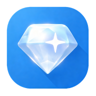

  
  <h1>Gram Wallet</h1>

  
  

  
  
  
  
  <!-- img alt="status" src="https://img.shields.io/badge/status-STABLE-green" style="margin: 0px 2px;" -->

 

  
Android-виджет и приложение для карточки Telegram / TON-кошелька — баланс GRAM, фон с подарками и QR для получения.

## Что делает

- Виджет на домашнем экране с карточкой кошелька
- Баланс GRAM / TON и стоимость в USD
- Оформление карточки как в Telegram Wallet: подарки, фон, паттерн
- QR для получения и копирование адреса
- История платежей, токены и NFT
- Опциональные локальные уведомления о транзакциях
- Баннер обновления, когда вышел новый APK
- Значок спонсора для тех, кто пожертвовал (по желанию)

Только просмотр: публичный адрес. Без подписания транзакций, без seed и без приватных ключей.

Не связано с Telegram и TON Foundation.